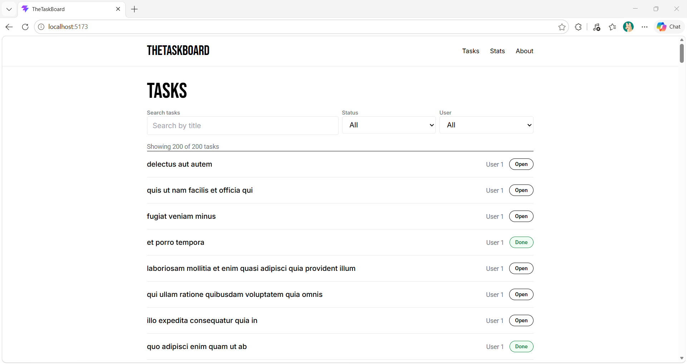
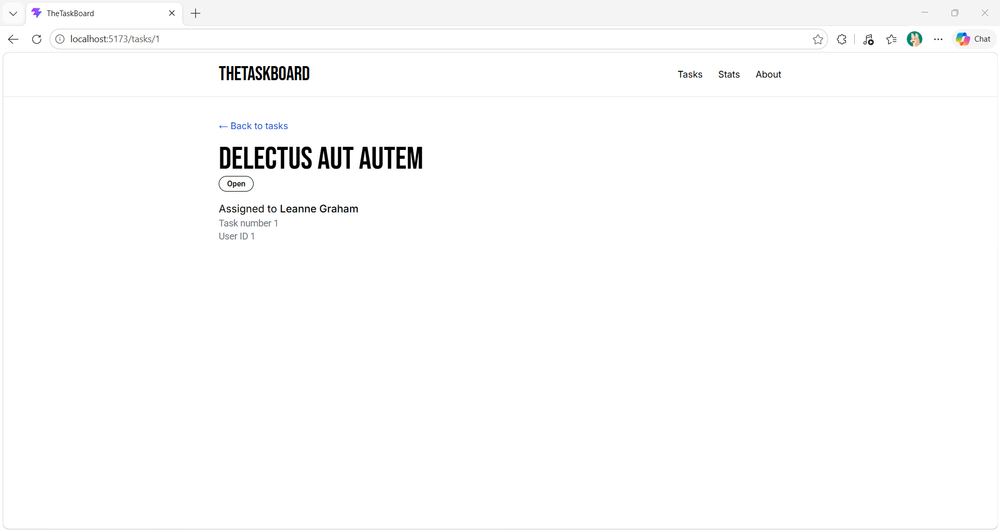
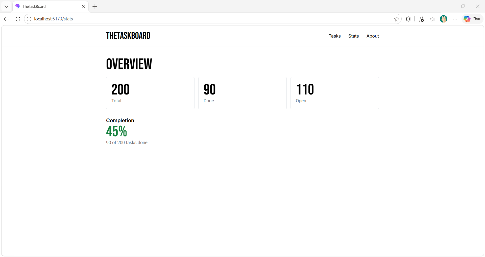
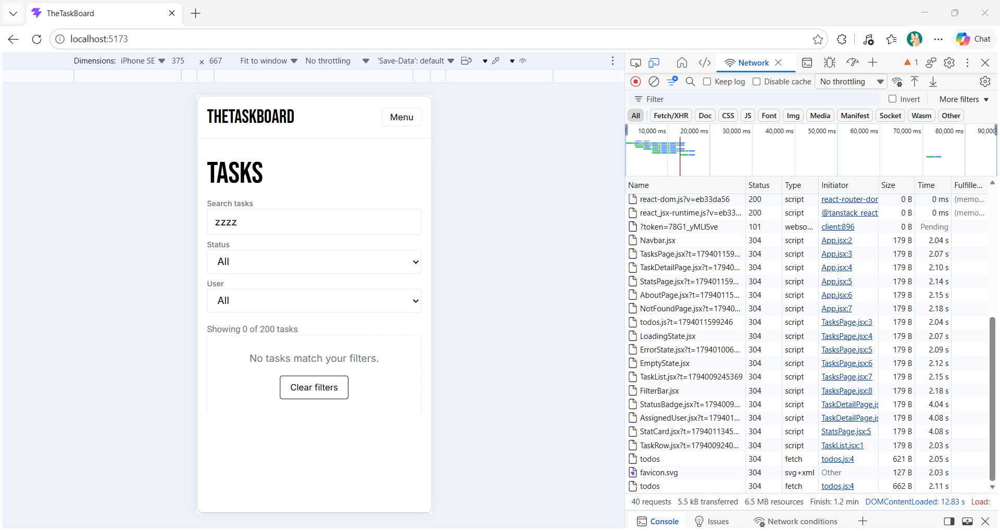
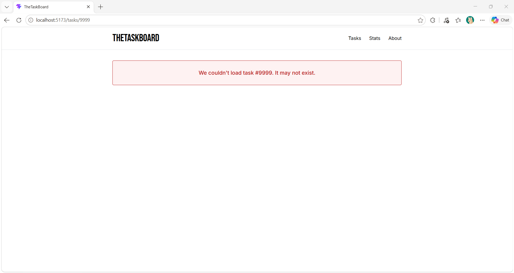

# # TheTaskBoard

A minimalist task manager that loads tasks from a public API. You can search

and filter tasks, open any task to see who it's assigned to, and check overall

progress on the Overview page.

## Features

### Routes

- `/` Tasks: all 200 tasks with search, status and user filters

- `/tasks/:id` Task detail: one task, its status and its assignee

- `/stats` Overview: total, done and open counts, plus completion percentage

- `/about` About the app

- Any other URL shows a Not found page

### Public API

JSONPlaceholder: `/todos`, `/todos/:id` and `/users/:id`

### TanStack Query and UI states

- `useQuery` with the keys `['todos']`, `['todo', id]` and `['user', userId]`

- Tasks and Overview share `['todos']`, so the second page loads from the cache

| State   | How to see it                                   |

|---------|-------------------------------------------------|

| Loading | DevTools, Network, Slow 4G, then refresh         |

| Empty   | Search "zzzz" on the Tasks page                  |

| Error   | Visit /tasks/9999                                |

## Screenshots











## Setup

```

git clone <your-repo-url>

cd thetaskboard

npm install

npm run dev

```

## Tech stack

React, React Router, TanStack Query, Tailwind CSS, Vite.

## Live demo (stretch)

(Optional Vercel URL)
